# Graph RAG Knowledge Graph View

This is a live visual representation of the entities and connections stored inside the local SQLite database.

## Graph Database Statistics
- **Total Nodes**: 42
- **Total Edges**: 161

## Graph Traversal Visualizer

```mermaid
graph TD
  %% Node Styles
  classDef route fill:#1f77b4,stroke:#fff,stroke-width:2px,color:#fff;
  classDef type fill:#aec7e8,stroke:#fff,stroke-dasharray: 5 5,color:#333;
  classDef month fill:#ff7f0e,stroke:#fff,stroke-width:2px,color:#fff;
  classDef offer fill:#2ca02c,stroke:#fff,stroke-width:2px,color:#fff;
  classDef pattern fill:#d62728,stroke:#fff,stroke-width:2px,color:#fff;
  classDef macro fill:#9467bd,stroke:#fff,stroke-dasharray: 3 3,color:#fff;

  month_4["April"]
  class month_4 month
  month_8["August"]
  class month_8 month
  bank_offer_Axis_0["Axis Flipkart Monsoon"]
  class bank_offer_Axis_0 offer
  route_BOM_BLR["Route: BOM-BLR"]
  class route_BOM_BLR route
  route_BOM_GOI["Route: BOM-GOI"]
  class route_BOM_GOI route
  month_12["December"]
  class month_12 month
  route_DEL_BLR["Route: DEL-BLR"]
  class route_DEL_BLR route
  route_DEL_BOM["Route: DEL-BOM"]
  class route_DEL_BOM route
  route_DEL_GOI["Route: DEL-GOI"]
  class route_DEL_GOI route
  route_DEL_HYD["Route: DEL-HYD"]
  class route_DEL_HYD route
  route_DEL_MAA["Route: DEL-MAA"]
  class route_DEL_MAA route
  event_type_airline_sale["Macro/Event: airline_sale"]
  class event_type_airline_sale macro
  event_type_bank_sale["Macro/Event: bank_sale"]
  class event_type_bank_sale macro
  event_type_capacity_cut["Macro/Event: capacity_cut"]
  class event_type_capacity_cut macro
  event_type_fuel_drop["Macro/Event: fuel_drop"]
  class event_type_fuel_drop macro
  event_type_fuel_spike["Macro/Event: fuel_spike"]
  class event_type_fuel_spike macro
  event_type_long_weekend["Macro/Event: long_weekend"]
  class event_type_long_weekend macro
  event_type_major_festival["Macro/Event: major_festival"]
  class event_type_major_festival macro
  event_type_monsoon_low["Macro/Event: monsoon_low"]
  class event_type_monsoon_low macro
  event_type_new_route_capacity["Macro/Event: new_route_capacity"]
  class event_type_new_route_capacity macro
  event_type_school_vacation["Macro/Event: school_vacation"]
  class event_type_school_vacation macro
  month_2["February"]
  class month_2 month
  bank_offer_HDFC_0["HDFC SmartBuy Monthly"]
  class bank_offer_HDFC_0 offer
  month_1["January"]
  class month_1 month
  month_7["July"]
  class month_7 month
  month_6["June"]
  class month_6 month
  month_3["March"]
  class month_3 month
  month_5["May"]
  class month_5 month
  month_11["November"]
  class month_11 month
  month_10["October"]
  class month_10 month
  pattern_p001["Pattern p001: Diwali + 14 days + T-7 booking..."]
  class pattern_p001 pattern
  pattern_p002["Pattern p002: Monsoon + beach route = 15-20%..."]
  class pattern_p002 pattern
  pattern_p003["Pattern p003: Fuel spike >20% in 30 days lea..."]
  class pattern_p003 pattern
  pattern_p004["Pattern p004: SBI Tuesday sale offers consis..."]
  class pattern_p004 pattern
  pattern_p005["Pattern p005: Tuesday/Wednesday departures a..."]
  class pattern_p005 pattern
  route_type_BEACH["Type: BEACH"]
  class route_type_BEACH type
  route_type_BEACH_TOURISM["Type: BEACH_TOURISM"]
  class route_type_BEACH_TOURISM type
  route_type_BUSINESS["Type: BUSINESS"]
  class route_type_BUSINESS type
  route_type_METRO["Type: METRO"]
  class route_type_METRO type
  route_type_METRO_BUSINESS["Type: METRO_BUSINESS"]
  class route_type_METRO_BUSINESS type
  bank_offer_SBI_0["SBI Tuesday Sale"]
  class bank_offer_SBI_0 offer
  month_9["September"]
  class month_9 month

  %% Edge Relationships
  bank_offer_Axis_0 -- active_in --> month_7
  bank_offer_Axis_0 -- active_in --> month_8
  bank_offer_Axis_0 -- active_in --> month_9
  bank_offer_HDFC_0 -- active_in --> month_1
  bank_offer_HDFC_0 -- active_in --> month_10
  bank_offer_HDFC_0 -- active_in --> month_11
  bank_offer_HDFC_0 -- active_in --> month_12
  bank_offer_HDFC_0 -- active_in --> month_2
  bank_offer_HDFC_0 -- active_in --> month_3
  bank_offer_HDFC_0 -- active_in --> month_4
  bank_offer_HDFC_0 -- active_in --> month_5
  bank_offer_HDFC_0 -- active_in --> month_6
  bank_offer_HDFC_0 -- active_in --> month_7
  bank_offer_HDFC_0 -- active_in --> month_8
  bank_offer_HDFC_0 -- active_in --> month_9
  bank_offer_SBI_0 -- active_in --> month_1
  bank_offer_SBI_0 -- active_in --> month_10
  bank_offer_SBI_0 -- active_in --> month_11
  bank_offer_SBI_0 -- active_in --> month_12
  bank_offer_SBI_0 -- active_in --> month_2
  bank_offer_SBI_0 -- active_in --> month_3
  bank_offer_SBI_0 -- active_in --> month_4
  bank_offer_SBI_0 -- active_in --> month_5
  bank_offer_SBI_0 -- active_in --> month_6
  bank_offer_SBI_0 -- active_in --> month_7
  bank_offer_SBI_0 -- active_in --> month_8
  bank_offer_SBI_0 -- active_in --> month_9
  event_type_airline_sale -- affects_route --> route_BOM_BLR
  event_type_airline_sale -- affects_route --> route_BOM_GOI
  event_type_airline_sale -- affects_route --> route_DEL_BLR
  event_type_airline_sale -- affects_route --> route_DEL_BOM
  event_type_airline_sale -- affects_route --> route_DEL_GOI
  event_type_airline_sale -- affects_route --> route_DEL_HYD
  event_type_airline_sale -- affects_route --> route_DEL_MAA
  event_type_bank_sale -- affects_route --> route_BOM_BLR
  event_type_bank_sale -- affects_route --> route_BOM_GOI
  event_type_bank_sale -- affects_route --> route_DEL_BLR
  event_type_bank_sale -- affects_route --> route_DEL_BOM
  event_type_bank_sale -- affects_route --> route_DEL_GOI
  event_type_bank_sale -- affects_route --> route_DEL_HYD
  event_type_bank_sale -- affects_route --> route_DEL_MAA
  event_type_capacity_cut -- affects_route --> route_BOM_BLR
  event_type_capacity_cut -- affects_route --> route_BOM_GOI
  event_type_capacity_cut -- affects_route --> route_DEL_BLR
  event_type_capacity_cut -- affects_route --> route_DEL_BOM
  event_type_capacity_cut -- affects_route --> route_DEL_GOI
  event_type_capacity_cut -- affects_route --> route_DEL_HYD
  event_type_capacity_cut -- affects_route --> route_DEL_MAA
  event_type_fuel_drop -- affects_route --> route_BOM_BLR
  event_type_fuel_drop -- affects_route --> route_BOM_GOI
  event_type_fuel_drop -- affects_route --> route_DEL_BLR
  event_type_fuel_drop -- affects_route --> route_DEL_BOM
  event_type_fuel_drop -- affects_route --> route_DEL_GOI
  event_type_fuel_drop -- affects_route --> route_DEL_HYD
  event_type_fuel_drop -- affects_route --> route_DEL_MAA
  event_type_fuel_spike -- affects_route --> route_BOM_BLR
  event_type_fuel_spike -- affects_route --> route_BOM_GOI
  event_type_fuel_spike -- affects_route --> route_DEL_BLR
  event_type_fuel_spike -- affects_route --> route_DEL_BOM
  event_type_fuel_spike -- affects_route --> route_DEL_GOI
  event_type_fuel_spike -- affects_route --> route_DEL_HYD
  event_type_fuel_spike -- affects_route --> route_DEL_MAA
  event_type_long_weekend -- affects_route --> route_BOM_BLR
  event_type_long_weekend -- affects_route --> route_BOM_GOI
  event_type_long_weekend -- affects_route --> route_DEL_BLR
  event_type_long_weekend -- affects_route --> route_DEL_BOM
  event_type_long_weekend -- affects_route --> route_DEL_GOI
  event_type_long_weekend -- affects_route --> route_DEL_HYD
  event_type_long_weekend -- affects_route --> route_DEL_MAA
  event_type_major_festival -- affects_route --> route_BOM_BLR
  event_type_major_festival -- affects_route --> route_BOM_GOI
  event_type_major_festival -- affects_route --> route_DEL_BLR
  event_type_major_festival -- affects_route --> route_DEL_BOM
  event_type_major_festival -- affects_route --> route_DEL_GOI
  event_type_major_festival -- affects_route --> route_DEL_HYD
  event_type_major_festival -- affects_route --> route_DEL_MAA
  event_type_monsoon_low -- active_in --> month_6
  event_type_monsoon_low -- active_in --> month_7
  event_type_monsoon_low -- active_in --> month_8
  event_type_monsoon_low -- active_in --> month_9
  event_type_monsoon_low -- affects_route --> route_BOM_GOI
  event_type_monsoon_low -- affects_route --> route_DEL_GOI
  event_type_new_route_capacity -- affects_route --> route_BOM_BLR
  event_type_new_route_capacity -- affects_route --> route_BOM_GOI
  event_type_new_route_capacity -- affects_route --> route_DEL_BLR
  event_type_new_route_capacity -- affects_route --> route_DEL_BOM
  event_type_new_route_capacity -- affects_route --> route_DEL_GOI
  event_type_new_route_capacity -- affects_route --> route_DEL_HYD
  event_type_new_route_capacity -- affects_route --> route_DEL_MAA
  event_type_school_vacation -- active_in --> month_12
  event_type_school_vacation -- active_in --> month_5
  event_type_school_vacation -- active_in --> month_6
  event_type_school_vacation -- affects_route --> route_BOM_GOI
  event_type_school_vacation -- affects_route --> route_DEL_GOI
  pattern_p002 -- active_in --> month_6
  pattern_p002 -- active_in --> month_7
  pattern_p002 -- active_in --> month_8
  pattern_p002 -- linked_to --> route_type_BEACH
  pattern_p005 -- linked_to --> route_type_BEACH
  pattern_p005 -- linked_to --> route_type_BUSINESS
  pattern_p005 -- linked_to --> route_type_METRO
  route_BOM_BLR -- active_in --> month_1
  route_BOM_BLR -- active_in --> month_10
  route_BOM_BLR -- active_in --> month_11
  route_BOM_BLR -- active_in --> month_12
  route_BOM_BLR -- active_in --> month_2
  route_BOM_BLR -- active_in --> month_3
  route_BOM_BLR -- active_in --> month_6
  route_BOM_BLR -- active_in --> month_7
  route_BOM_BLR -- active_in --> month_8
  route_BOM_BLR -- linked_to --> route_type_BUSINESS
  route_BOM_GOI -- active_in --> month_1
  route_BOM_GOI -- active_in --> month_11
  route_BOM_GOI -- active_in --> month_12
  route_BOM_GOI -- active_in --> month_2
  route_BOM_GOI -- active_in --> month_6
  route_BOM_GOI -- active_in --> month_7
  route_BOM_GOI -- active_in --> month_8
  route_BOM_GOI -- linked_to --> route_type_BEACH
  route_DEL_BLR -- active_in --> month_1
  route_DEL_BLR -- active_in --> month_10
  route_DEL_BLR -- active_in --> month_11
  route_DEL_BLR -- active_in --> month_12
  route_DEL_BLR -- active_in --> month_2
  route_DEL_BLR -- active_in --> month_3
  route_DEL_BLR -- active_in --> month_6
  route_DEL_BLR -- active_in --> month_7
  route_DEL_BLR -- active_in --> month_8
  route_DEL_BLR -- linked_to --> route_type_BUSINESS
  route_DEL_BOM -- active_in --> month_1
  route_DEL_BOM -- active_in --> month_10
  route_DEL_BOM -- active_in --> month_11
  route_DEL_BOM -- active_in --> month_12
  route_DEL_BOM -- active_in --> month_6
  route_DEL_BOM -- active_in --> month_7
  route_DEL_BOM -- active_in --> month_8
  route_DEL_BOM -- linked_to --> route_type_METRO
  route_DEL_GOI -- active_in --> month_1
  route_DEL_GOI -- active_in --> month_11
  route_DEL_GOI -- active_in --> month_12
  route_DEL_GOI -- active_in --> month_2
  route_DEL_GOI -- active_in --> month_6
  route_DEL_GOI -- active_in --> month_7
  route_DEL_GOI -- active_in --> month_8
  route_DEL_GOI -- linked_to --> route_type_BEACH
  route_DEL_HYD -- active_in --> month_1
  route_DEL_HYD -- active_in --> month_10
  route_DEL_HYD -- active_in --> month_11
  route_DEL_HYD -- active_in --> month_12
  route_DEL_HYD -- active_in --> month_6
  route_DEL_HYD -- active_in --> month_7
  route_DEL_HYD -- active_in --> month_8
  route_DEL_HYD -- linked_to --> route_type_METRO
  route_DEL_MAA -- active_in --> month_1
  route_DEL_MAA -- active_in --> month_10
  route_DEL_MAA -- active_in --> month_11
  route_DEL_MAA -- active_in --> month_12
  route_DEL_MAA -- active_in --> month_6
  route_DEL_MAA -- active_in --> month_7
  route_DEL_MAA -- active_in --> month_8
  route_DEL_MAA -- linked_to --> route_type_METRO
```

## Entity Descriptions

### 1. Routes (Blue Nodes)
Represents flight origin-destination pairs. Linked to route types (e.g. `BEACH_TOURISM` vs `METRO_BUSINESS`) which dictate baseline demand characteristics.

### 2. Months (Orange Nodes)
Represent calendar month targets. Ingestion creates month-edges indicating peak tourist activity or active seasonal modifiers (like monsoons).

### 3. Bank Offers (Green Nodes)
Represents recurring credit card promos (SBI Tuesday, Axis Flipkart Monsoon, HDFC SmartBuy) mapped to their valid months to flag discounts.

### 4. Pricing Patterns (Red Nodes)
Causal inference pairs gathered from historical analysis (e.g., T-7 booking spikes, monsoon discounts on beach routes).
